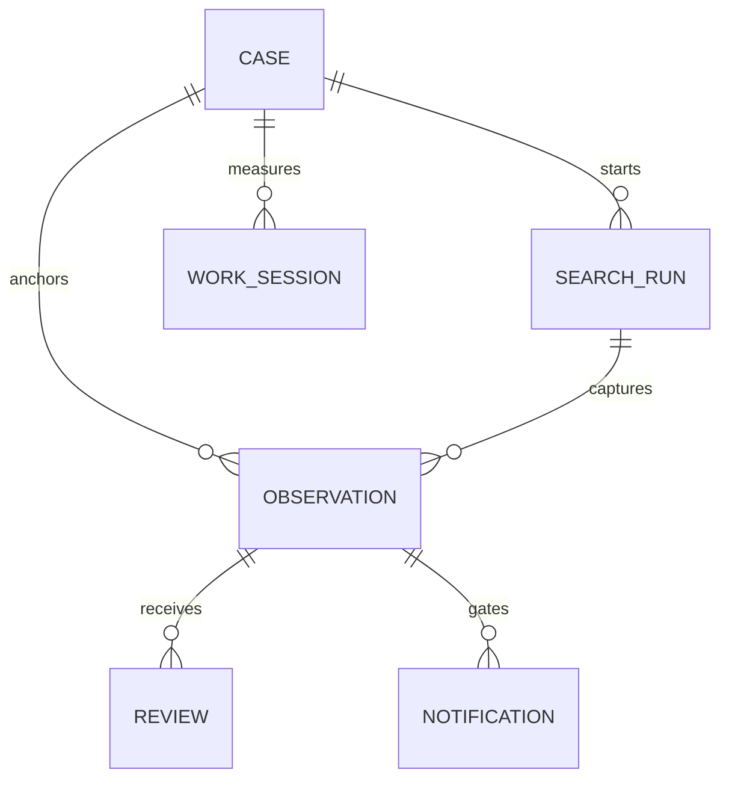

# How this first build works

## Local review interface update

The W1 revision adds a browser review interface on top of the same CLI/store
architecture described below. Run `npm run review` for the shared local database
or `npm run review:demo` for isolated synthetic practice data. Read
[LOCAL_REVIEW.md](LOCAL_REVIEW.md) for the new module map, setup and workflow.
References below to a CLI-only starting point describe the initial slice; the
review interface is now implemented. Camera input and image similarity remain
out of scope for this revision.

## Purpose of the first slice

The broader idea is to correlate physical object sightings with online representations of the same objects. The bike MVP builds the registry, online candidate search, evidence, review, and measurement parts. It does not yet ingest camera footage or perform visual similarity matching. The case/listing data structures are deliberately object-based so a future sighting adapter can reuse the same matching and review concepts.

The project is named Traces and lives at https://github.com/Parado-xy/Traces. The initial build was packaged under the working name Trace / Shadow.

This version is a CLI because its immediate job is to test whether a disciplined matching workflow is useful. A dashboard would improve side-by-side image review, but it would not establish that candidate quality is good. First we need real reviewed examples and reliable measurements.

## Why TypeScript and SQLite

TypeScript aligns with your work on TradeAgent and SonicPages and keeps application logic in a language you already use. SQLite gives you a real transactional store in one local file. Node 24 executes this style of TypeScript directly and includes the SQLite interface, fetch, and test runner. TypeScript annotations are stripped at runtime; static checking still matters and runs separately through `npm run check`.

There is no NestJS application, Redis queue, hosted database, inference service, or container setup to maintain in this version. The domain and adapter boundaries leave room for those later if workload or deployment needs justify them. The current database is a single-user research store.

## The records and relationships

**Case:** a normalized Bike Index record with a source ID, make, model, color alternatives, serial, components, description, image URLs, theft location/date, and current local status. Descriptions are retained as prose; the tool does not pretend it can reliably separate distinctive markings from arbitrary text yet. Dedicated markings are used in the staged fixture and can later be populated by a reviewed extraction workflow.

**Search run:** one query for one specific open case, with source, start/end times, and completed or failed status. No query can start without an existing open case. eBay returns at most 25 listings in one run; manual import accepts at most 100 case-specific entries. A manual run records the actual query the operator says they used.

**Observation:** one listing snapshot from one run, paired with the case snapshot it was scored against. It contains listing provenance, object attributes, the scoring version, the entire score explanation, and a fingerprint of the case attributes. Repeated discovery of the same listing creates another observation rather than silently replacing earlier evidence.

**Review:** an append-only verdict event containing observation ID, reviewer, notes, and time. The latest verdict controls the current state; older verdicts remain available. A verdict on an older observation cannot authorize the newer snapshot. Changing case attributes also invalidates the old review for current action.

**Work session:** manually recorded minutes for either assisted or manual work. Multiple sessions sum per case. The initial tool records time rather than estimating it from wall-clock gaps between CLI commands; those gaps can include breaks and unrelated work.

**Notification:** an attempted outward message and its delivery state. A unique case/listing identity cannot automatically be sent twice, even after a new snapshot. An uncertain network outcome remains uncertain until a person reconciles it.

## Ingestion

The Bike Index adapter first searches a specific geographic region, then retrieves detail for each returned case. The detail read provides components and photos and checks whether the bike is still stolen. The live smoke test used Grambling, Louisiana, within 100 miles and imported two real records.

Normalization is a whitelist. It does not persist the original API response, owner contact fields, police records, or coordinates. It preserves the public report URL so you can inspect the authoritative record. Missing values stay missing; they are not generated by an LLM.

`refresh` reads one case again. Search results are not a permanent assertion that a bike remains stolen. Notification performs an additional authoritative status and attribute check immediately before sending, but there is necessarily still a small interval between that read and the provider receiving the message.

## Candidate search

The eBay adapter follows the official OAuth and Browse API routes. It derives the query from the case make and model and limits results to bicycles. Tokens are kept in process memory, not in the database. There is no seller lookup. Raw responses are discarded after object fields are normalized.

Without eBay credentials, the working end-to-end route is manual case-specific listing entry. You inspect permitted sources yourself, save relevant object details using the supplied JSON template, and import them into the same scoring/review path. The tool never loads the pasted URL, so importing a candidate does not start a hidden scraping operation.

The access boundary is explicit: sandbox is the default; production requires appropriate credentials and confirmation that the application purpose is permitted. Other marketplaces remain manual until a permitted automated route is established.

## Scoring

The first matcher is deliberately deterministic. Every point has an explanation you can inspect and a test you can understand.

| Attribute | Maximum points | Evidence rule |
| --- | ---: | --- |
| Make | 20 | Explicit structured agreement or complete normalized phrase in title/description |
| Model | 25 | Explicit structured agreement or complete normalized phrase |
| Color | 10 | At least one color alternative overlaps; gray/grey normalized |
| Components | 10 | Fraction of complete case component phrases found |
| Distinctive markings | 15 | Fraction of complete case marking phrases found |
| Serial | 20 | Exact normalized serial supplied explicitly in listing attributes |

Total possible evidence is always 100. Missing fields contribute zero; they do not shrink the denominator. Otherwise a sparse listing could receive an inflated score merely because one common attribute agrees. Unknown serial placeholders never count as an exact identifier.

An explicit make, model, or color disagreement caps the total at 35. An explicit serial disagreement caps it at 10. Those caps are starting heuristics, not empirically learned rules. The explanation preserves the raw positive evidence and conflicts, so the point sum can exceed the final capped total.

The score is a ranking aid, not a probability that the object is stolen or belongs to an owner. Color in text may describe an accessory rather than the frame, and a model phrase can appear in a compatibility description. Those are known limits of text matching. Price and geography are shown for review but do not affect the score; there is no validated distance or pricing model.

All case-specific returned candidates enter the queue, including low scores. The first version does not silently discard borderline candidates or send on a threshold. The benchmark alone applies a configurable threshold so we can evaluate the ranking rule against labels.

## Human review and notifications

Inspect the case, candidate photographs, serial evidence, and distinctive features. Choose `match`, `not_match`, or `unsure`, with notes describing the evidence. The software enforces the presence of a reviewer and notes, but a CLI cannot prove that a human actually examined the evidence. Operator discipline remains part of the experiment.

`notify` without `--send` generates a local draft only. A real send requires the latest match verdict, current case fingerprint, non-staged data, current Bike Index stolen status, matching current authoritative attributes, an approved application setup, and the appropriate OAuth token. The only outward notification destination is Bike Index's stolen-bike endpoint. The code has no seller messaging feature.

The sender records an attempt before the HTTP request. That avoids blind duplicate retries if delivery succeeds but the response is lost. Success is recorded as sent. Any request/parsing error becomes `unknown_or_failed`; the tool does not claim the message definitely failed to arrive.

Notification mechanics have been tested with mocked HTTP requests. The provider's authorized own-bike integration test is still outstanding. No real outward message was sent while building this version.

## Measuring usefulness honestly

For real cases, the metrics report shows cases, unique candidates per case, match/rejection/unsure counts, unresolved or stale evidence, and manual/assisted minutes. It uses only each listing's latest snapshot and latest verdict, excluding staged cases. Historical observations remain stored, but repeated search results do not inflate current candidate counts.

Reviewed precision is `match / (match + not_match)`. Unsure and unreviewed candidates are displayed separately. This is provisional human-reviewed precision because the verifier can be wrong; confirmed recovery is a stronger outcome. Rejection fraction is `not_match / (match + not_match)`. That fraction must not be mislabeled as a population false-positive rate.

A true benchmark needs labeled positives and negatives. Its counts are:

- TP: actual matching objects surfaced above the threshold.
- FP: nonmatching objects surfaced above the threshold.
- TN: nonmatching objects below the threshold.
- FN: matching objects below the threshold.

Then precision is `TP/(TP+FP)`, FPR is `FP/(FP+TN)`, and miss rate is `FN/(FN+TP)`. Empty denominators return null, never a fabricated zero.

The included synthetic text set deliberately produces one false positive and one miss at threshold 50. This proves the reporting does not hide errors. It does not estimate field performance. The next experiment is the staged owned-object photo exercise from the brief, with ground truth kept separate from the reviewer and multiple similar distractors. Image matching itself has not been implemented.

Time savings need controlled comparisons, not illustrative command values. Use a consistent task, record active minutes, rotate the order of manual/assisted trials to reduce learning effects, and report both per-case outcomes and total unresolved cases. Retrieval misses outside the collected pool remain unknown even when the within-pool benchmark looks good.

## Retention and audit limits

Retention defaults to 30 days, enforced each time the CLI opens its database. Old cases and old searches are removed along with their dependent evidence/reviews, and the database is vacuumed after purging. Refreshing a case renews its case retention window; it does not renew old search snapshots. The application audit stores short events and internal identifiers rather than duplicate seller descriptions.

Retention is not a background service in this build. If the tool is never opened, nothing runs. Exported JSON, backups, and external files are outside the database purge. There is no encryption at rest beyond what your host filesystem provides, and the audit is not tamper-evident. These limits matter before deploying this for other operators.

Structured fields exclude seller identities, but free-form listing descriptions and review notes can still contain personal information if pasted carelessly. Automated PII redaction is not claimed. Keep entered text restricted to object evidence.

## How to study the code

Start with `src/domain.ts` to learn the records. Read `src/score.ts` next and follow one synthetic fixture through each point rule. Then read `src/store.ts` for transactions, observation history, verdicts, retention, and metrics. After that, inspect the two adapters and `src/notify.ts` for network boundaries. `src/cli.ts` wires those pieces into commands.

Run `npm run demo` and identify why the sparse positive is missed and why the look-alike negative scores highly. Change a fixture in a temporary copy, predict the result, and rerun the benchmark. This is a useful way to stay involved in the implementation while using AI for the heavier scaffolding.

## Next build priorities

1. Configure eBay sandbox access and validate the adapter against real provider responses; confirm production-purpose permission before enabling live inventory.
2. Review a small real candidate set manually and record actual active review/search time.
3. Arrange the authorized Bike Index own-bike notification integration test.
4. Run the staged owned-object blind benchmark with enough distractors to reveal confusion.
5. Build side-by-side image review once the observation and verdict model survives actual use.
6. Add image similarity only after establishing a text-only baseline, preserving the same evidence and verification boundaries.

These steps advance the bike wedge while preserving the broader object-correlation architecture. Camera-stream ingestion remains MVP 2.
